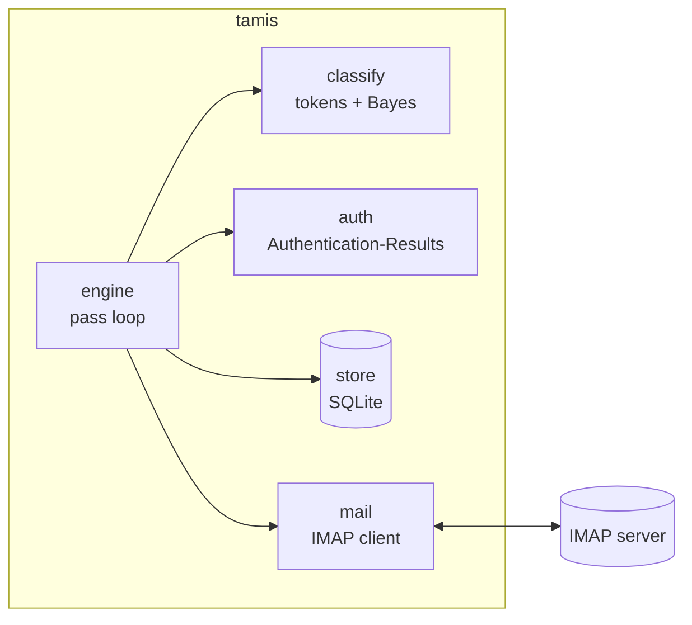
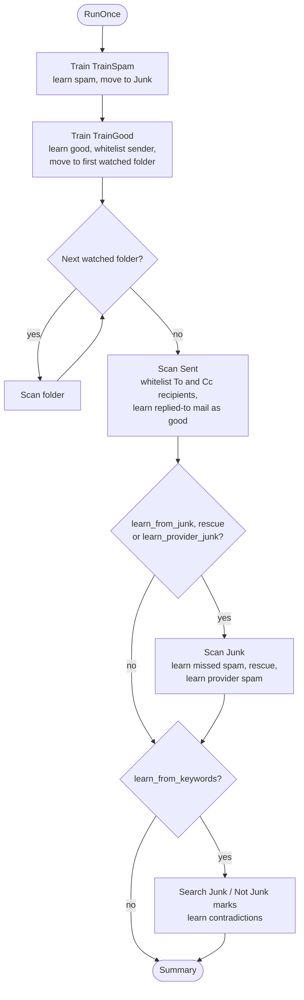
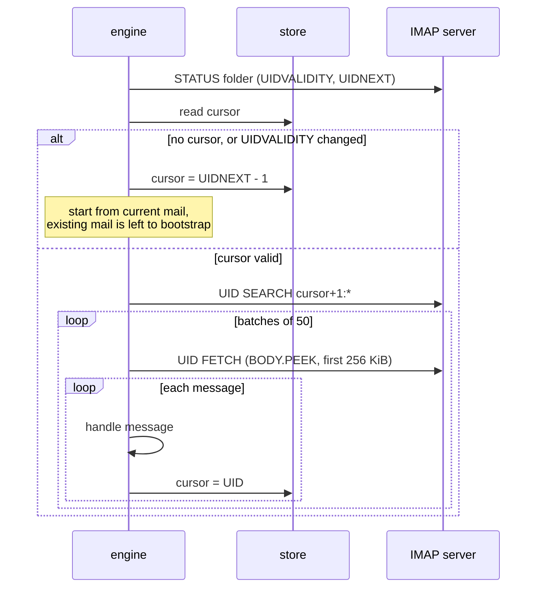
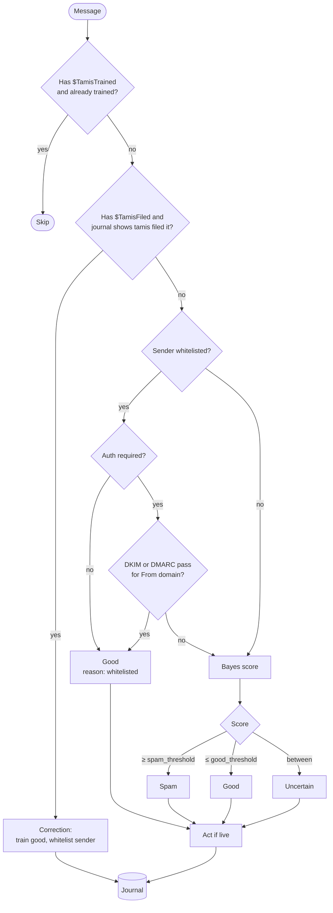
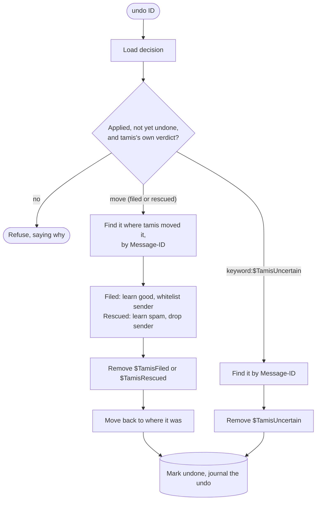
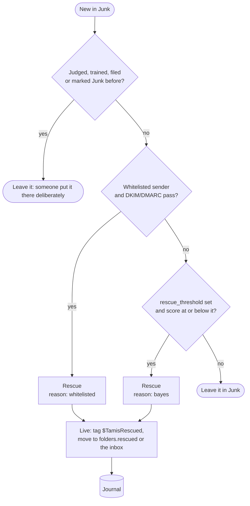
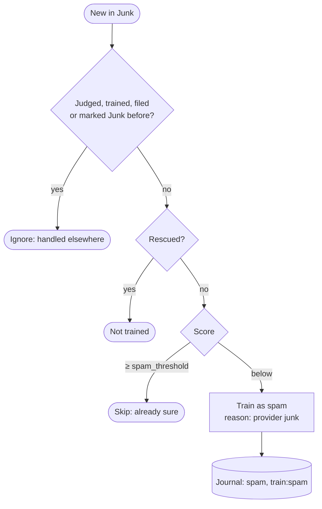
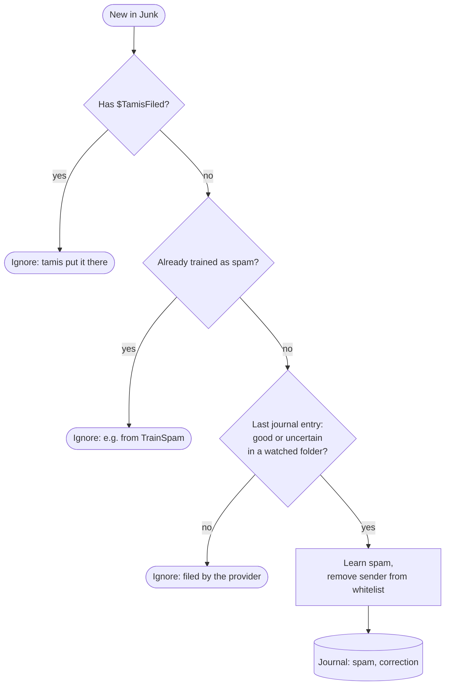
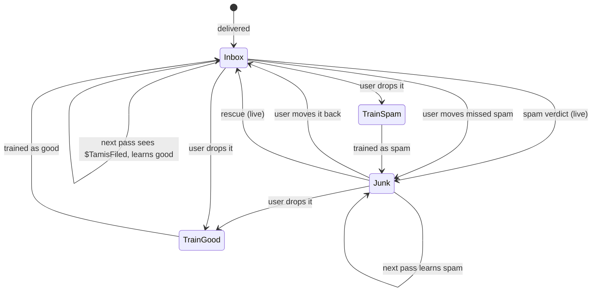
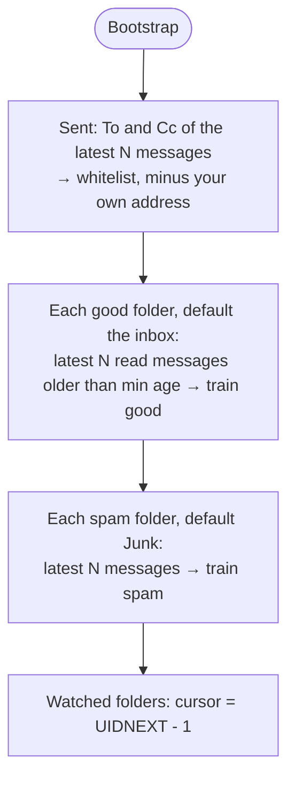

# Engine

How tamis processes mail. This describes what the code in
[`internal/engine`](../internal/engine) does today; [`design.md`](design.md)
covers where it is heading.

## Components

| Package | Role |
|---|---|
| `mail` | IMAP operations: folder state, UID search, peeked fetch, move, keywords |
| `classify` | Turns a message into tokens and scores them (SpamBayes-style chi-square) |
| `auth` | Decides whether the provider authenticated the `From` domain |
| `store` | Token counts, trained messages, whitelist, folder cursors, decision journal |
| `engine` | Runs passes: trains, judges, files and records |

## A pass

`RunOnce` is one pass over the account. The daemon repeats it when new mail
arrives in the first watched folder, or after `policy.poll_interval` if none
does. Between passes it IDLEs on a second connection to the first watched
folder. Before idling it compares the folder's UIDNEXT with the cursor the pass
saved, so mail that arrived in between starts the next pass at once. It falls
back to plain sleeping when the server doesn't advertise IDLE, the connection
fails, or the last pass failed. Everything else (training folders, Sent, Junk, marks)
is still only looked at on a pass.

Training folders go first. A message the user has just trained is recorded
as trained, so when it lands back in the inbox in the same pass, the scan
skips it instead of judging it again.

Sent has a cursor like a watched folder, but its messages are not judged:
every To and Cc address of a new one is whitelisted, minus your own address.
If a new message replies (`In-Reply-To`) to one tamis judged spam or uncertain,
that message is learnt as good and its sender whitelisted, like a Not Junk
mark: answering it says it isn't spam. The original is looked for where it was
judged and in Junk; if it is gone, nothing is learnt.
Mail already in Sent when tamis first sees the folder is left to
`tamis bootstrap --sent`. A Sent folder that can't be scanned (say the name in
`folders.sent` doesn't exist) is logged as a warning and doesn't fail the pass.

Training folders are processed in both modes. Dropping a message into one is
an explicit request, not a judgement tamis makes on its own. The same goes for
the Junk scan, which learns from your moves and from the provider's filing.

## Scanning a folder

Each scanned folder has a cursor in the store: the highest UID processed,
valid for one UIDVALIDITY. The cursor is saved after every message, so an
interrupted pass resumes where it stopped.

`BODY.PEEK` means scanning never marks mail as read.

## Judging a message

**Corrections.** In live mode, tamis tags spam with `$TamisFiled` before moving
it to Junk. If that message turns up in a watched folder again, the user moved
it back. tamis treats this as "not spam": it trains the message as good and
whitelists the sender.

**Sender verification.** A whitelisted address only counts when the provider's
`Authentication-Results` header shows DMARC passing for the `From` domain, or
DKIM passing for that domain or a parent of it (relaxed alignment). Only the
topmost header is read: the provider prepends its own, and anything further
down may have been written by the sender.

iCloud prepends one header per check (`bimi.icloud.com`, `dmarc.icloud.com`,
`dkim-verifier.icloud.com`, ...), so its topmost header never carries a DMARC
or DKIM result. Given the provider's domain, tamis reads the leading headers
whose authserv-id is that domain or a subdomain, up to the first that isn't,
and only the first header per id. The domain comes from `account.auth_server_id`
if set (`"none"` turns this off), else from what `tamis bootstrap` learnt: it
counts the registered domain of the topmost header's authserv-id over the
messages it trains on, and takes the one that heads nine in ten of at least 20.
A sample that can't tell leaves what was learnt before. The domain is saved
with the IMAP host it was learnt for: if `account.host` later differs (you moved
to another provider), the learnt domain is not used, only the topmost header
counts, and `tamis status`, `tamis doctor` and the `run` log say to run
`tamis bootstrap` again. `tamis status` shows which is in use. Set `policy.whitelist_requires_auth = false` to trust the
address alone.

**Scoring.** `classify` tokenizes the subject, the `From` address and domain,
the `To` and `Cc` addresses and their domains (at most ten addresses), the
words in text and HTML parts, and the hosts of links. Each token's spam
probability is smoothed towards 0.5 when it has been seen rarely. The 150 most
decisive tokens are combined with Fisher's chi-square method into a score from
0 (good) to 1 (spam). A message with no decisive tokens scores 0.5, which
falls in the uncertain band.

**Recipients.** Mail to an address you don't normally get mail on is a strong
sign of spam (BCC blasts, relays, a stranger's address). Besides the `to:`
tokens, each message gets one `rcpt:` token: `rcpt:mine` if some recipient is
your account address or has been a recipient of at least three good messages,
`rcpt:other` if there are recipients but none of those, `rcpt:none` if there are
none. Only good mail teaches which addresses are expected, so a spammer's
target address stays unexpected. The token depends on what the model has
learnt, so it is worked out each time a message is scored or trained, and
stored with the training. Messages learnt before this existed carry no
recipient tokens; the model picks them up from new mail, or from
`tamis bootstrap --refresh`, which learns them again.

## Actions

| Verdict | Live mode | Shadow mode | Journal action |
|---|---|---|---|
| spam | add `$TamisFiled`, move to Junk | nothing | `move:Junk` |
| uncertain | add `$TamisUncertain` | nothing | `keyword:$TamisUncertain` |
| rescued (in Junk) | add `$TamisRescued`, move to the inbox | nothing | `move:INBOX` |
| good | nothing | nothing | `none` |

Every decision is journalled with its verdict, reason (`bayes`,
`whitelisted`, `correction`, `train folder`, `provider junk`), score, planned action and
whether that action was applied. In shadow mode, the journal shows what live
mode would have done; `tamis log` prints it.

`tamis log` marks a decision `(corrected by N)` when a later `correction` or
`undo` entry exists for the same Message-ID. The link is derived from the
journal when it is read, not stored on the decision, so the two can't disagree.
`tamis learn` without a label refuses such a decision; `--good` or `--spam`
changes it again. `tamis doctor`'s correction rate counts judged decisions that
were corrected.

`tamis run` prunes the journal when it starts and then once a day: decisions
older than `policy.journal_retention` (default `8760h`, a year; `0s` keeps
everything) are deleted. A failed prune is logged and doesn't stop the loop. Training and the whitelist are not touched. A decision that has been
pruned can no longer be undone or learnt from by ID, and tamis no longer
remembers having judged that message.

## Undo

`tamis undo ID...` reverses decisions that were applied in live mode, using
the IDs `tamis log` shows.

The message is found by Message-ID rather than UID, because a move gives it a
new UID. Undo refuses:

- decisions only recorded in shadow mode;
- decisions already undone;
- training and corrections, which are changed by dropping the message in the
  other training folder;
- messages no longer where tamis left them.

The decision is marked undone last, so an undo that fails partway (say the
move back fails) can simply be run again.

## Learn

`tamis learn [--good|--spam] ID...` teaches tamis the right answer for a
decision it only recorded, which is what shadow mode produces. With no flag it
learns the opposite of the verdict; an uncertain verdict needs a flag. It
trains the message and updates the whitelist like an undo would, but moves
nothing and sets no keyword, and journals the result as a `correction`.

It refuses decisions that were applied (use `undo`) and anything that isn't
tamis's own judgement, such as training and corrections.

## Rescue

With `policy.rescue` on (the default), the Junk scan also looks for good
mail the provider filed there.

- **Only mail tamis never saw.** Anything tamis judged, trained or filed, and
  anything you marked Junk, was put in Junk on purpose.
- **Authentication is always required** for the whitelist route, even with
  `whitelist_requires_auth = false`: phishing that impersonates a contact is
  exactly what ends up in Junk.
- **Score-based rescue is off** until you set `rescue_threshold` (e.g. 0.05).
  It must be below `good_threshold`.
- A rescued message is not judged again in the inbox. Move it back to Junk and
  tamis learns it as spam and drops the sender from the whitelist; `tamis
  undo` does the same.

## Provider-filed Junk

With `policy.learn_provider_junk` on (the default), mail the provider files to
Junk that tamis never saw is also training data. After rescue has had its
turn, each such arrival is scored:

- **Only what it doesn't already know.** Mail scoring at or above
  `spam_threshold` would only reinforce the model; the mistakes and doubts are
  what it learns from.
- **Tokens only.** The sender stays on the whitelist if they are on it: a
  forged message from a contact lands in Junk too, and learning it must not
  cost you the real contact.
- **Both modes.** Like the other learning from the Junk folder, it happens in
  shadow mode too. It counts towards `Trained` in the pass summary.
- **Fixing a wrong one.** If the provider was wrong, drop the message in
  **TrainGood**: training it as good reverses the spam training and
  whitelists the sender. A Not Junk mark or a plain move to the inbox is not
  learnt, since tamis's decision for the message was made in Junk.
- Turn it off with `learn_provider_junk = false` if another program files mail
  to Junk that you don't want as training data.

## Missed spam

With `policy.learn_from_junk` on (the default), Junk has a cursor too. Each
new arrival is looked up in the journal by Message-ID:

A message tamis let through that turns up in Junk was moved there by someone,
and tamis assumes it was you. Mail.app's own junk filter or SpamSieve moving
mail looks exactly the same, so turn `learn_from_junk` off if you run either.

## Junk and Not Junk marks

Mail clients' Junk / Not Junk buttons set keywords: `$Junk` / `$NotJunk`, or
Apple Mail's `Junk` / `NotJunk`. With `policy.learn_from_keywords` on (the
default), each pass searches the watched folders and Junk for them on mail
from the last 7 days.

A server-side search finds marks without tracking flag changes, so this works
whether or not the server's CONDSTORE does. Headers come first; a message's
body is only downloaded once it is known to be learnt.

| Mark | Learnt when tamis judged it | Learns |
|---|---|---|
| Junk | good or uncertain | spam; sender off the whitelist |
| Not Junk | spam or uncertain (shadow verdicts too) | good; sender whitelisted |

Marks that agree with tamis, marks on mail tamis never judged, and messages
marked both ways are ignored: Apple Mail's own junk filter sets these keywords
too, so only a mark that contradicts tamis is taken as yours. Each message is
learnt once.

## Where messages go

## Bootstrap

`Bootstrap` seeds a new installation, then starts every watched folder from
its current mail.

Good mail is learnt before spam, because the recipient status of a message
depends on which addresses good mail has gone to.

`--refresh` learns mail that was already learnt again: each message is
untrained, then trained with today's tokens, under its folder's label. That
brings what was learnt before up to date after the tokenizer gains a feature.
It leaves the whitelist and the watch positions alone (unless `--sent` is
named), and counts as "Refreshed" the messages that had been learnt. Mail
learnt from a folder it has since left, or through a training folder, isn't
found; name the folders it is in now with `-s` and `-g`.

Bootstrap also learns the provider's authserv-id domain from the messages it
reads (see Sender verification), including when named folders limit it.

Only *read* mail past a minimum age is trained as good. Unread or recent
mail could be spam that slipped through and that nobody has looked at yet.

## Safety rules

- **Never delete.** tamis only moves mail and sets keywords.
- **No unsafe moves.** If the server has neither MOVE nor UIDPLUS, `Move`
  refuses: the only fallback would be a bare `EXPUNGE`, which could purge
  other messages already marked `\Deleted`.
- **Shadow mode is the default.** Watched-folder decisions are only journalled
  until `policy.mode = "live"`.
- **No false corrections.** If moving a spam to Junk fails, tamis takes
  `$TamisFiled` off again. If that fails too (a dropped connection), the
  keyword alone is not believed: a correction needs the journal to show that
  tamis moved the message. The same goes for `$TamisRescued`.
- **Reused Message-IDs don't skip the filter.** Mail tamis already trained and
  moved on carries `$TamisTrained`, which senders can't set. A message with a
  trained Message-ID but no such keyword is judged like any other.
- **No hung passes.** A pass lasts at most 10 minutes, and when it ends (or on
  SIGTERM) the connection is dropped, so a server that stops answering can't
  stall the loop. Progress is saved per message and resumes next pass.
- **Peek only.** Fetches use `BODY.PEEK`, capped at 256 KiB per message.
- **Train once per message.** Training is keyed by Message-ID (or a content
  hash when there is none). Training a message again with the other label
  reverses the first training instead of counting it twice.

## Limitations

- IDLE watches only the first watched folder.
- One connection per pass, reopened every pass, plus one for IDLE between them.
- Corrections rely on `$TamisFiled` surviving a move back from Junk. Servers
  that drop keywords on MOVE won't report corrections; the training folders
  still work.
