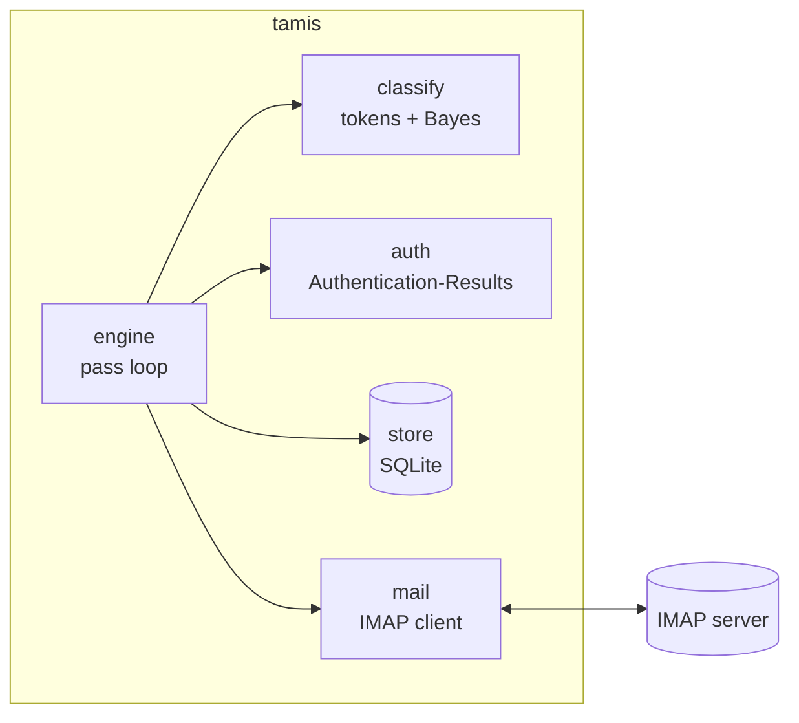
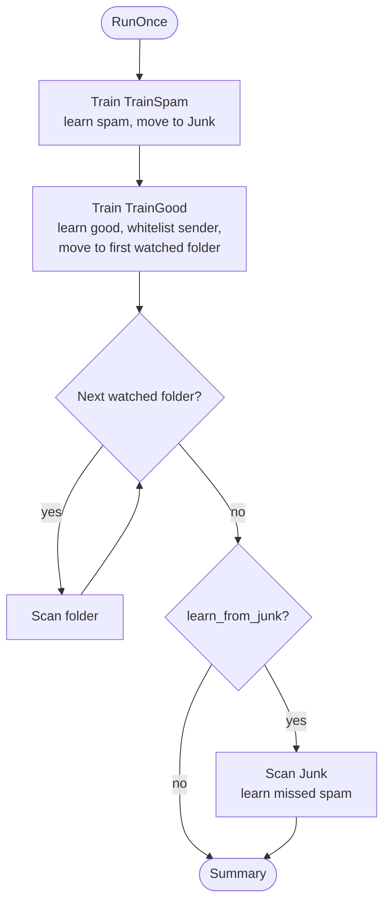
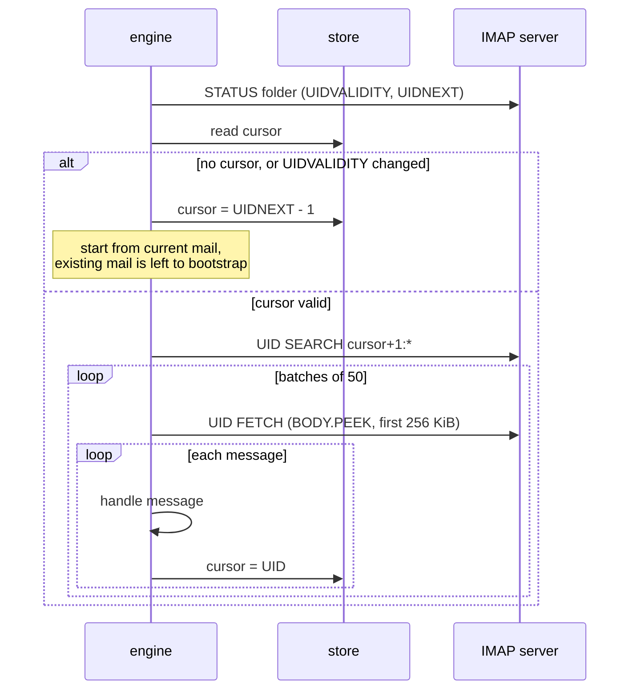
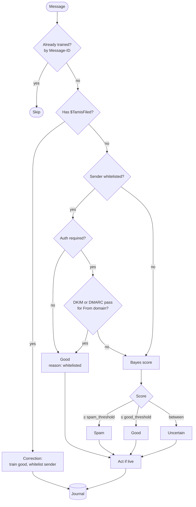
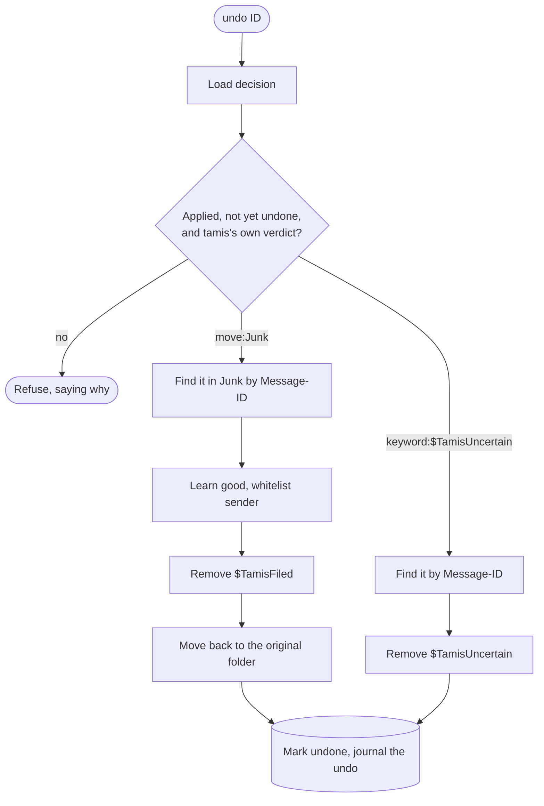
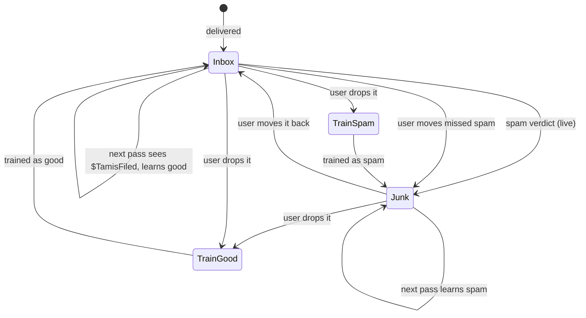
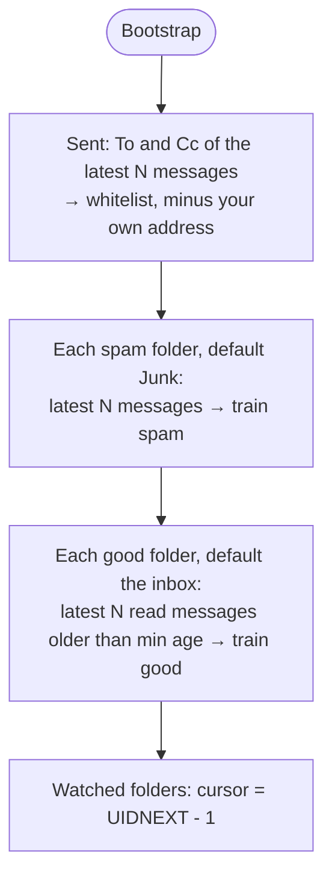

# Engine

How tamis processes mail. This describes what the code in
[`internal/engine`](../internal/engine) does today; [`design.md`](design.md)
covers where it is heading.

## Components

| Package | Role |
|---|---|
| `mail` | IMAP operations: folder state, UID search, peeked fetch, move, keywords |
| `classify` | Turns a message into tokens and scores them (SpamBayes-style chi-square) |
| `auth` | Decides whether the provider authenticated the `From` domain |
| `store` | Token counts, trained messages, whitelist, folder cursors, decision journal |
| `engine` | Runs passes: trains, judges, files and records |

## A pass

`RunOnce` is one pass over the account. The daemon repeats it every
`policy.poll_interval`.

Training folders go first. A message the user has just trained is recorded
as trained, so when it lands back in the inbox in the same pass, the scan
skips it instead of judging it again.

Training folders are processed in both modes. Dropping a message into one is
an explicit request, not a judgement tamis makes on its own. The same goes for
the Junk scan, which only learns from your moves.

## Scanning a folder

Each watched folder has a cursor in the store: the highest UID processed,
valid for one UIDVALIDITY. The cursor is saved after every message, so an
interrupted pass resumes where it stopped.

`BODY.PEEK` means scanning never marks mail as read.

## Judging a message

**Corrections.** In live mode, tamis tags spam with `$TamisFiled` before moving
it to Junk. If that message turns up in a watched folder again, the user moved
it back. tamis treats this as "not spam": it trains the message as good and
whitelists the sender.

**Sender verification.** A whitelisted address only counts when the provider's
`Authentication-Results` header shows DMARC passing for the `From` domain, or
DKIM passing for that domain or a parent of it (relaxed alignment). Only the
topmost header is read: the provider prepends its own, and anything further
down may have been written by the sender. Set
`policy.whitelist_requires_auth = false` to trust the address alone.

**Scoring.** `classify` tokenizes the subject, the `From` address and domain,
the words in text and HTML parts, and the hosts of links. Each token's spam
probability is smoothed towards 0.5 when it has been seen rarely. The 150 most
decisive tokens are combined with Fisher's chi-square method into a score from
0 (good) to 1 (spam). A message with no decisive tokens scores 0.5, which
falls in the uncertain band.

## Actions

| Verdict | Live mode | Shadow mode | Journal action |
|---|---|---|---|
| spam | add `$TamisFiled`, move to Junk | nothing | `move:Junk` |
| uncertain | add `$TamisUncertain` | nothing | `keyword:$TamisUncertain` |
| good | nothing | nothing | `none` |

Every decision is journalled with its verdict, reason (`bayes`,
`whitelisted`, `correction`, `train folder`), score, planned action and
whether that action was applied. In shadow mode, the journal shows what live
mode would have done; `tamis log` prints it.

## Undo

`tamis undo ID...` reverses decisions that were applied in live mode, using
the IDs `tamis log` shows.

The message is found by Message-ID rather than UID, because a move gives it a
new UID. Undo refuses:

- decisions only recorded in shadow mode;
- decisions already undone;
- training and corrections, which are changed by dropping the message in the
  other training folder;
- messages no longer where tamis left them.

The decision is marked undone last, so an undo that fails partway (say the
move back fails) can simply be run again.

## Missed spam

With `policy.learn_from_junk` on (the default), Junk has a cursor too. Each
new arrival is looked up in the journal by Message-ID:

A message tamis let through that turns up in Junk was moved there by someone,
and tamis assumes it was you. Mail.app's own junk filter or SpamSieve moving
mail looks exactly the same, so turn `learn_from_junk` off if you run either.

## Where messages go

## Bootstrap

`Bootstrap` seeds a new installation, then starts every watched folder from
its current mail.

Only *read* mail past a minimum age is trained as good. Unread or recent
mail could be spam that slipped through and that nobody has looked at yet.

## Safety rules

- **Never delete.** tamis only moves mail and sets keywords.
- **No unsafe moves.** If the server has neither MOVE nor UIDPLUS, `Move`
  refuses: the only fallback would be a bare `EXPUNGE`, which could purge
  other messages already marked `\Deleted`.
- **Shadow mode is the default.** Watched-folder decisions are only journalled
  until `policy.mode = "live"`.
- **No false corrections.** If moving a spam to Junk fails, tamis takes
  `$TamisFiled` off again. Otherwise the retry would read the keyword as the
  user moving the message back, and learn it as good.
- **Peek only.** Fetches use `BODY.PEEK`, capped at 256 KiB per message.
- **Train once per message.** Training is keyed by Message-ID (or a content
  hash when there is none). Training a message again with the other label
  reverses the first training instead of counting it twice.

## Limitations

- Polling only; no IDLE yet.
- One connection, reopened every pass.
- Corrections rely on `$TamisFiled` surviving a move back from Junk. Servers
  that drop keywords on MOVE won't report corrections; the training folders
  still work.
- No rescue from the provider's Junk yet (see the roadmap in `design.md`).
