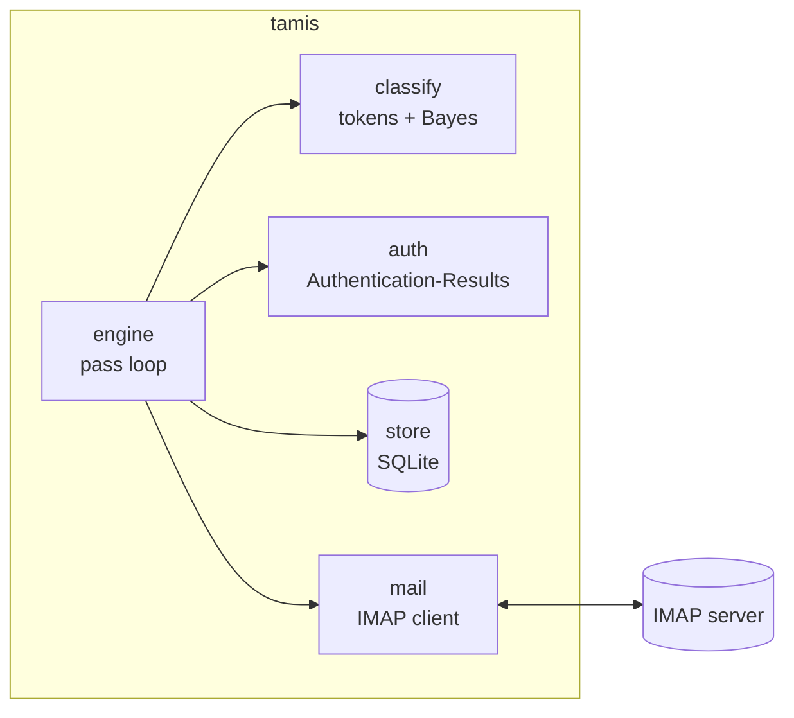
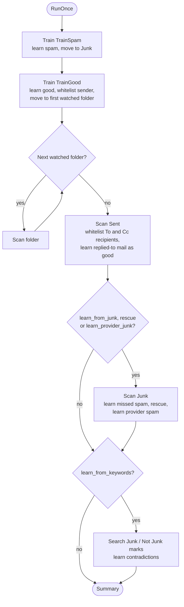
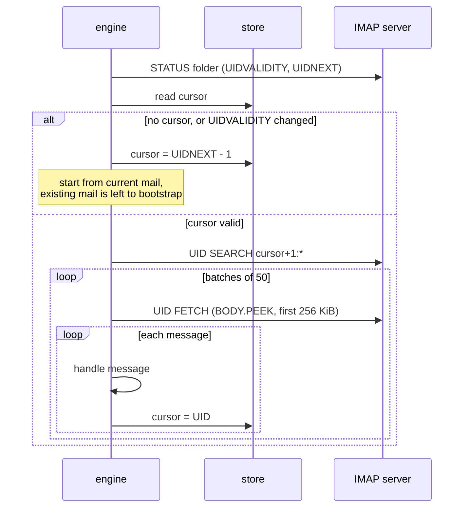
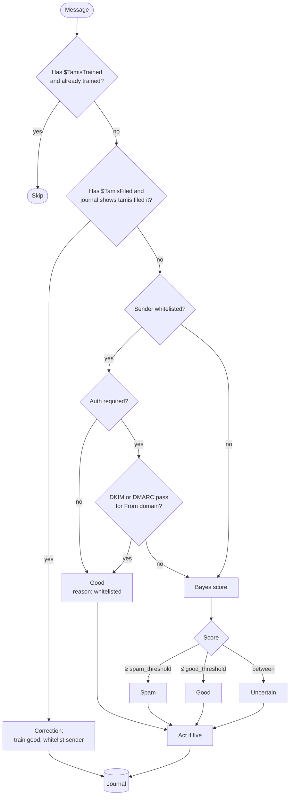
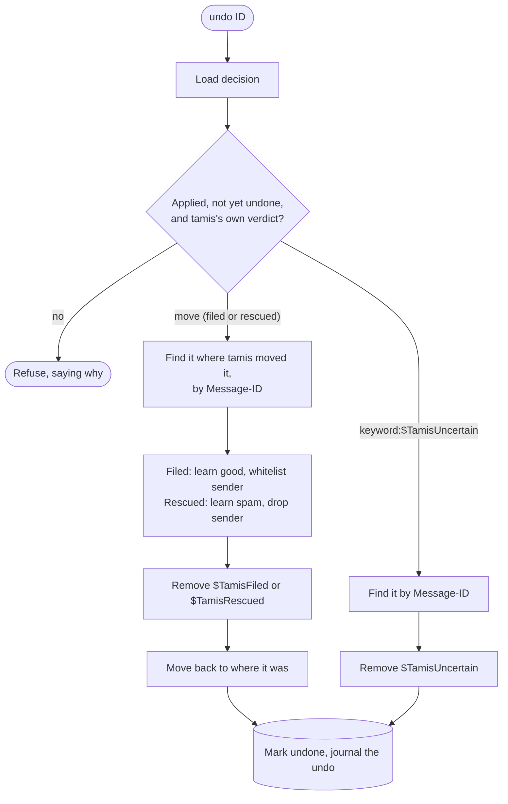
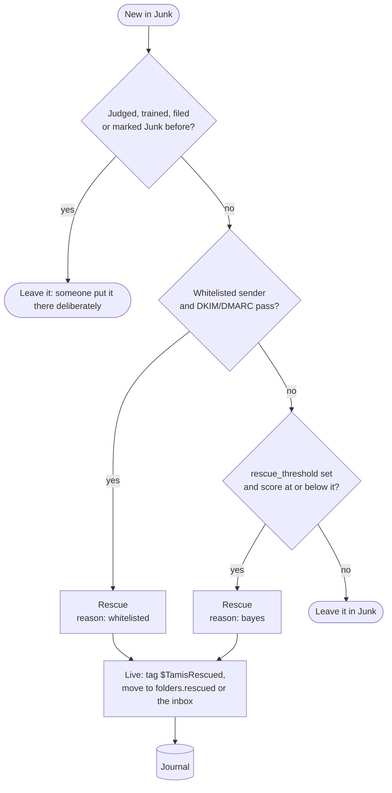
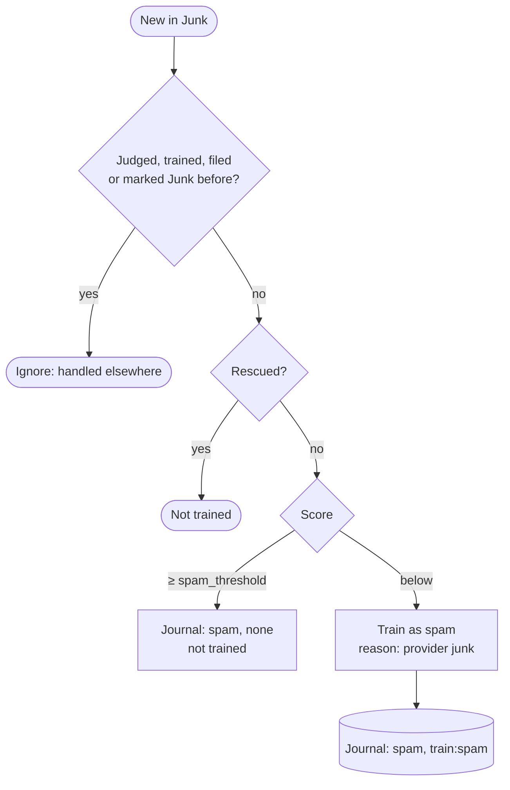
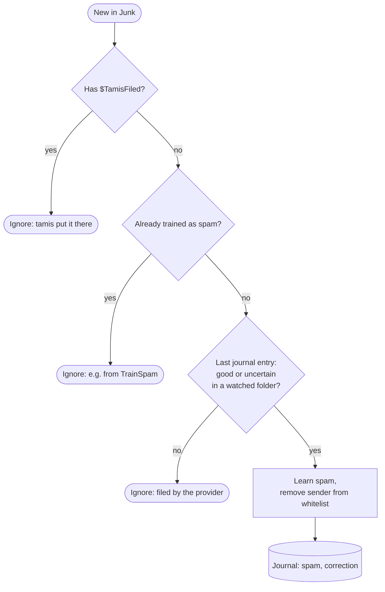
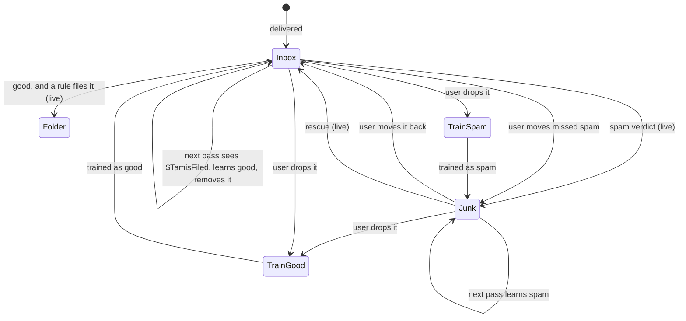
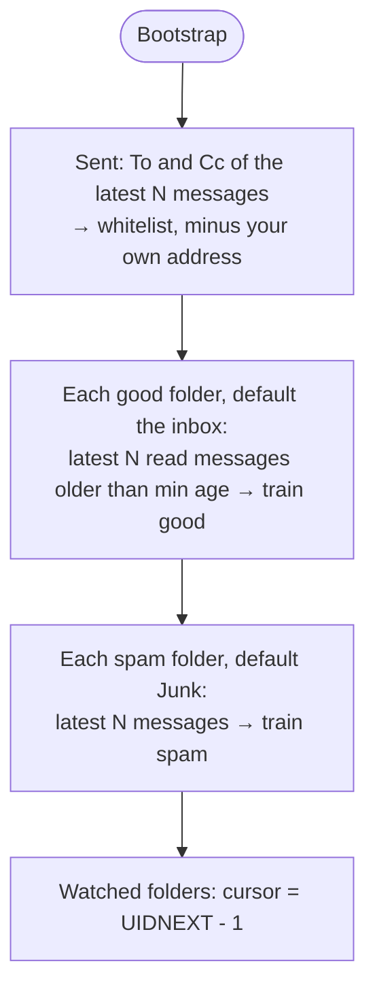

How tamis processes mail: it judges each new message (spam, good or
uncertain), moves spam to Junk, rescues good mail from Junk, and can file good
mail into folders with [Sieve rules](../../how-it-works/rules/). This describes what the code in
[`src/engine`](https://github.com/hugoh/tamis/tree/main/src/engine) does today; [`design.md`](../../how-it-works/design/)
covers where it is heading.

## Components



| Package | Role |
|---|---|
| `mail` | IMAP operations: folder state, UID search, peeked fetch, move, keywords, IDLE watching (see [imap.md](../../how-it-works/imap/)) |
| `classify` | Turns a message into tokens and scores them (SpamBayes-style chi-square, see [Tokens and scoring](../../how-it-works/engine/#tokens-and-scoring)) |
| `auth` | Decides whether the provider authenticated the `From` domain |
| `store` | Token counts, trained messages, whitelist, folder cursors and mod-sequences, decision journal |
| `rules` | Runs the user's Sieve script on a message and names the folder to file it in (see [rules.md](../../how-it-works/rules/)) |
| `engine` | Runs passes: trains, judges, files and records |

## A pass

`RunOnce` is one pass over the account. The daemon repeats it when a watcher
hears of new mail or changed flags in a watched folder, or after
`policy.poll_interval` if none does. Each watched folder has its own long-lived
IDLE connection, kept across passes, so a junk mark set in another client is
learnt straight away and a quiet mailbox costs no logins. A folder whose
connection fails is retried with a growing wait; one whose server can't IDLE is
given up on, and the poll covers it. Everything else (training folders, Sent, Junk, including marks
set in Junk) is still only looked at on a pass. [imap.md](../../how-it-works/imap/) lists the
commands behind each step.



Training folders go first. A message the user has just trained is recorded
as trained, so when it lands back in the inbox in the same pass, the scan
skips it instead of judging it again.

Sent has a cursor like a watched folder, but its messages are not judged:
every To and Cc address of a new one is whitelisted, minus your own address.
Each message that adds addresses is journalled as `good` with reason `sent` and
action `none`; the log's From column lists the recipients. It can't be undone
or learnt from, and doesn't count towards `tamis doctor`'s rates.
If a new message replies (`In-Reply-To`) to one tamis judged spam or uncertain,
that message is learnt as good and its sender whitelisted, like a Not Junk
mark: answering it says it isn't spam. The original is looked for where it was
judged and in Junk; if it is gone, nothing is learnt.
Mail already in Sent when tamis first sees the folder is left to
`tamis bootstrap --sent`. A Sent folder that can't be scanned (say the name in
`folders.sent` doesn't exist) is logged as a warning and doesn't fail the pass.
A dropped connection is different: the connection is gone for the rest of the
pass too, so it fails the pass, which is retried after a wait that grows from
the poll interval while passes keep failing. How the passes are going is saved
in the state database for `tamis doctor` to show; see
[imap.md](../../how-it-works/imap/).

Training folders are processed in both modes. Dropping a message into one is
an explicit request, not a judgement tamis makes on its own. The same goes for
the Junk scan, which learns from your moves and from the provider's filing.

## Scanning a folder

Each scanned folder has a cursor in the store: the highest UID processed,
valid for one UIDVALIDITY. The cursor is saved after every message, so an
interrupted pass resumes where it stopped.



`BODY.PEEK` means scanning never marks mail as read.

## Judging a message



**Corrections.** In live mode, tamis tags spam with `$TamisFiled` before moving
it to Junk. If that message turns up in a watched folder again, the user moved
it back. tamis treats this as "not spam": it trains the message as good,
whitelists the sender and removes `$TamisFiled`, so that moving the message to
Junk again later is learnt as missed spam.

**Sender verification.** A whitelisted address only counts when the provider's
`Authentication-Results` header shows DMARC passing for the `From` domain, or
DKIM passing for that domain or a parent of it (relaxed alignment). Only the
topmost header is read: the provider prepends its own, and anything further
down may have been written by the sender.

iCloud prepends one header per check (`bimi.icloud.com`, `dmarc.icloud.com`,
`dkim-verifier.icloud.com`, ...), so its topmost header never carries a DMARC
or DKIM result. Given the provider's domain, tamis reads the leading headers
whose authserv-id is that domain or a subdomain, up to the first that isn't,
and only the first header per id. The domain comes from `account.auth_server_id`
if set (`"none"` turns this off), else from what `tamis bootstrap` learnt: it
counts the registered domain of the topmost header's authserv-id over the
messages it trains on, and takes the one that heads nine in ten of at least 20.
A sample that can't tell leaves what was learnt before. The domain is saved
with the IMAP host it was learnt for: if `account.host` later differs (you moved
to another provider), the learnt domain is not used, only the topmost header
counts, and `tamis doctor` and the `run` log say to run
`tamis bootstrap` again. `tamis doctor` shows which is in use. Set `policy.whitelist_requires_auth = false` to trust the
address alone.

**Impersonation.** Authentication shows who sent a message, not whether
they are who they claim to be. Phishing sent through a real service (SendGrid
accounts that were compromised or signed up for the occasion) passes SPF,
DKIM and DMARC for the sender's own domain while the display name says
"SendGrid Account Team". `auth::impersonated` catches the simplest form of
this. It takes a list of brands, each a name and the domains that may use it,
and flags a message when:

- the `From` display name contains a brand's name, ignoring case, and
- the `From` address is on none of that brand's domains or their subdomains.

`SendGrid <noreply@sendgrid.com>` and `SENDGRID <a@mail.sendgrid.com>` pass.
`SendGrid <noreply@averiware.com>`, a lookalike such as `notsendgrid.com`,
and `sendgrid.com.evil.example` are flagged. A message with no `From` or no
display name is never flagged. The test does not look at whether the message
authenticated, because the impersonator's own domain usually does.

It does not catch lures whose display name claims nothing (`noreply
<noreply@example.com>` with the subject "Receipt from SendGrid API"). Those
still depend on the Bayes score.

*Status.* The check is a tested building block that nothing calls. The
engine doesn't use it, no config supplies the brand list, and it changes no
score, verdict or rescue. It stays unwired because it needs a list of brands
that someone has to maintain, and the cases it catches are narrow. The
[phishing investigation](../../how-it-works/design/#phishing-through-real-sending-services)
has the evidence and what would change that. The fixtures
`tests/fixtures/mail/phish-*.eml` and `tests/auth_impersonation.rs` pin the
behaviour.

**Scoring.** `classify` turns the message into tokens and combines the most
decisive ones into a score from 0 (good) to 1 (spam). [Tokens and
scoring](../../how-it-works/engine/#tokens-and-scoring) says how.

**Recipients.** Mail to an address you don't normally get mail on is a strong
sign of spam (BCC blasts, relays, a stranger's address). Besides the `to:`
tokens, each message gets one `rcpt:` token: `rcpt:mine` if some recipient is
your account address or has been a recipient of at least three good messages,
`rcpt:other` if there are recipients but none of those, `rcpt:none` if there are
none. Only good mail teaches which addresses are expected, so a spammer's
target address stays unexpected. The token depends on what the model has
learnt, so it is worked out each time a message is scored or trained, and
stored with the training. Messages learnt before this existed carry no
recipient tokens; the model picks them up from new mail, or from
`tamis bootstrap --refresh`, which learns them again.

## Tokens and scoring

### Tokens

`classify` reduces a message to a set of distinct tokens. Each counts once per
message, however often it appears. The prefix keeps a word in the subject apart
from the same word in the body.

| Token | Source | Example |
|---|---|---|
| `subject:<word>` | words of the decoded `Subject` | `subject:invoice` |
| `from:<address>` | `From` address, lowercased; the display name is ignored | `from:billing@example.com` |
| `from-domain:<domain>` | domain of the `From` address | `from-domain:example.com` |
| `to:<address>` | `To` and `Cc` addresses, at most ten distinct | `to:me@example.net` |
| `to-domain:<domain>` | domains of those addresses | `to-domain:example.net` |
| `rcpt:<status>` | one per message; see Recipients above | `rcpt:mine` |
| `url:<host>` | host of each link, then each parent domain down to the registrable one | `url:a.b.example.co.uk`, `url:b.example.co.uk`, `url:example.co.uk` |
| `skip:<letter> <length>` | each word longer than 12 characters | `skip:a 20` |
| `<word>` | words of the text and HTML parts | `invoice` |
| `<pair>` | two neighbouring characters of Chinese, Japanese or Thai text, with the same prefix as a word | `账户` |

The words are made like this:

- Only `text/plain` and `text/html` parts are read, each up to its first
  64 KiB. A part without a content type counts as plain text. Attachments and
  other types are ignored.
- In HTML, the visible text and the `href` of each link are kept. Scripts,
  styles, tags and other attributes are not.
- Links are cut out of the text first, so only `url:` tokens come from them,
  never their paths or query strings. IP addresses are used as they are, with
  no parent domains.
- The text is lowercased and split into words by the Unicode word-boundary
  rules (UAX #29, via the `unicode-segmentation` crate). Apostrophes and
  decimal points inside a word don't split it, so `don't` and `3.14` are
  single words, and so are `foo_bar` and `abc123`. There is no stemming and
  no stop-word list.
- Chinese, Japanese hiragana and kanji, and Thai are written without spaces
  between words, so the rules can't find words in them. Each uninterrupted run
  of those characters (a space or punctuation ends it) becomes overlapping
  pairs instead: `您的账户` gives `您的`, `的账` and `账户`. A run of one
  character is kept as it is. In Thai the unit is a syllable cluster rather
  than a letter. These pairs ignore the minimum length below. Katakana words
  and Korean are not affected: they are separated by spaces or can be
  found by the word rules, so they are words like any other.
- Words of fewer than three characters are dropped. A word of more than twelve
  becomes a `skip:` token made of its first letter and its length rounded down
  to a multiple of ten, as SpamBayes does: long strings such as encoded
  blobs or tracking IDs are rarely the same twice, but their shape is. A
  `skip:` token has no `subject:` prefix.
- A message that can't be parsed into headers is tokenized whole, as if it
  were body text.

Other headers (`Received`, `Message-ID`, `Reply-To`, `X-Mailer`, `List-*`) and
the structure of the message are not tokenized. `Authentication-Results` only
feeds [sender verification](../../how-it-works/engine/#judging-a-message).

### Scoring

The method is that of [SpamBayes](https://spambayes.sourceforge.io/): Robinson's
token probabilities combined with Fisher's chi-square method. Apart from the
character pairs of unspaced scripts, it uses single words only, with no word
pairs.

1. **Per token.** For a token seen in `s` spam and `g` good trained messages,
   out of `S` spam and `G` good in all, the raw probability is
   `(s/S) / (s/S + g/G)`. Dividing by the class sizes keeps a big pile of good
   mail from drowning out the spam. With `n = s + g`, it is then pulled
   towards 0.5:

   ```text
   p = (0.45 × 0.5 + n × raw) / (0.45 + n)
   ```

   A token never seen has `p = 0.5`.
2. **Selection.** Tokens with `p` within 0.1 of 0.5 are ignored. Of the rest,
   the 150 furthest from 0.5 are kept; these are the clues.
3. **Combination.** With `p₁ … pₖ` the clues, Fisher's method turns the
   products of the `pᵢ` and of the `1 − pᵢ` into two chi-square tail
   probabilities, one for spam (`S`) and one for good (`H`). The score is
   `(S − H + 1) / 2`.

A score near 0.5 means either no evidence or evidence in both directions. A
message with no clues scores exactly 0.5.

The verdict compares the score to `policy.spam_threshold` (default 0.9) and
`policy.good_threshold` (default 0.2); in between is uncertain, as drawn in
[Judging a message](../../how-it-works/engine/#judging-a-message).

### Tokenizer version

Changing the tokenizer changes what counts as the same token, so counts learnt
before no longer match the tokens of new mail. tamis records which tokenizer
the counts were learnt with (`classify::TOKENIZER_VERSION`, kept in the
store's settings): the first message ever trained fixes it. A store that was
trained before versions were recorded counts as version 1.

When the stored version is not today's, `tamis run` logs a warning on its first
pass, and `tamis doctor` and the web Health page show a warning on the
"tokenizer" check. Mail still gets scored, but old and new tokens don't meet.
`tamis bootstrap --refresh` learns the mail again with today's tokenizer
(see [Bootstrap](../../how-it-works/engine/#bootstrap)) and records today's version once it is done. A
bootstrap without `--refresh` leaves the version alone, and so does every
message learnt along the way. Version 2 is the Unicode word rules and the pairs
for Chinese, Japanese and Thai.

A refresh learns again only what it fetches. Mail that was learnt from
somewhere else (a correction, a message in a training folder since emptied)
keeps its old tokens, so name every folder you trained from with `-s` and `-g`.

Measure a change to the tokenizer with `tamis-eval` first (see
[evaluation](../../how-it-works/evaluation/)), and raise the version when it
alters the tokens of existing mail.

## Actions

| Verdict | Live mode | Shadow mode | Journal action |
|---|---|---|---|
| spam | add `$TamisFiled`, move to Junk | nothing | `move:Junk` |
| uncertain | add `$TamisUncertain` | nothing | `keyword:$TamisUncertain` |
| rescued (in Junk) | add `$TamisRescued`, move to the inbox | nothing | `move:INBOX` |
| good | nothing | nothing | `none` |
| good, and a rule files it | add `$TamisSorted`, move to the rule's folder | nothing | `move:<folder>` |

Every decision is journalled with its verdict, reason (`bayes`,
`whitelisted`, `rule`, `correction`, `train folder`, `provider junk`, `undo`, `sent`), score, planned action and
whether that action was applied. In shadow mode, the journal shows what live
mode would have done; `tamis log` prints it.

`tamis log` marks a decision `(corrected by N)` when a later `correction` or
`undo` entry exists for the same Message-ID. The link is derived from the
journal when it is read, not stored on the decision, so the two can't disagree.
`tamis learn` without a label refuses such a decision; `--good` or `--spam`
changes it again, and the web UI's Spam and Good buttons are offered only on
decisions that have no correction yet. `tamis doctor`'s correction rate counts judged decisions that
were corrected.

`tamis run` prunes the journal when it starts and then once a day: decisions
older than `policy.journal_retention` (default `8760h`, a year; `0s` keeps
everything) are deleted. A failed prune is logged and doesn't stop the loop. Training and the whitelist are not touched. A decision that has been
pruned can no longer be undone or learnt from by ID, and tamis no longer
remembers having judged that message.

## Undo

`tamis undo ID...` reverses decisions that were applied in live mode, using
the IDs `tamis log` shows.



The message is found by Message-ID rather than UID, because a move gives it a
new UID. Undo refuses:

- decisions only recorded in shadow mode;
- decisions already undone;
- training, which is changed by dropping the message in the other training
  folder, and corrections, which `learn` changes;
- messages no longer where tamis left them.

The decision is marked undone last, so an undo that fails partway (say the
move back fails) can simply be run again.

The `undo` entry it journals carries the message's score after the retraining,
so the log shows how the filter now rates it, not 0.00.

## Learn

`tamis learn [--good|--spam] ID...` teaches tamis the right answer for a
decision it only recorded, which is what shadow mode produces, or one that
flagged the message uncertain. With no flag it learns the opposite of the
verdict; an uncertain verdict needs a flag. It trains the message and updates
the whitelist like an undo would, and journals the result as a `correction`.
It moves nothing and sets no keyword, with one exception: for a message
flagged `$TamisUncertain` it clears the flag, and learning it as spam also
moves it to Junk. That makes `learn` the way to answer an uncertain flag,
where `undo` only clears it and teaches nothing. The web UI offers Spam and
Good on those rows, and drops Undo once one is chosen.

It also changes a `correction`, for when the move that taught tamis was a
mistake: with no flag it learns the opposite, so correction #167 (good) becomes
spam. The message is looked for in the folder the decision names, then in Junk,
since it may have been moved since.

It refuses other decisions that were applied (use `undo`) and anything that isn't
tamis's own judgement or a correction, such as training.

## Rescue

With `policy.rescue` on (the default), the Junk scan also looks for good
mail the provider filed there.



- **Only mail tamis never saw.** Anything tamis judged, trained or filed, and
  anything you marked Junk, was put in Junk on purpose.
- **Authentication is always required** for the whitelist route, even with
  `whitelist_requires_auth = false`: phishing that impersonates a contact is
  exactly what ends up in Junk.
- **Score-based rescue is off** until you set `rescue_threshold` (e.g. 0.05).
  It must be below `good_threshold`.
- A rescued message is not judged again in the inbox. Move it back to Junk and
  tamis learns it as spam and drops the sender from the whitelist; `tamis
  undo` does the same.

## Provider-filed Junk

With `policy.learn_provider_junk` on (the default), mail the provider files to
Junk that tamis never saw is also training data. After rescue has had its
turn, each such arrival is scored:



- **Only what it doesn't already know.** Mail scoring at or above
  `spam_threshold` would only reinforce the model, so it is journaled (reason
  `provider junk`, action `none`) but not trained; the mistakes and doubts are
  what it learns from.
- **Tokens only.** The sender stays on the whitelist if they are on it: a
  forged message from a contact lands in Junk too, and learning it must not
  cost you the real contact.
- **Both modes.** Like the other learning from the Junk folder, it happens in
  shadow mode too. It counts towards `Trained` in the pass summary.
- **Fixing a wrong one.** If the provider was wrong, drop the message in
  **TrainGood**: training it as good reverses the spam training and
  whitelists the sender. A Not Junk mark or a plain move to the inbox is not
  learnt, since tamis's decision for the message was made in Junk.
- Turn it off with `learn_provider_junk = false` if another program files mail
  to Junk that you don't want as training data.

## Missed spam

With `policy.learn_from_junk` on (the default), Junk has a cursor too. Each
new arrival is looked up in the journal by Message-ID:



A message tamis let through that turns up in Junk was moved there by someone,
and tamis assumes it was you. Mail.app's own junk filter or SpamSieve moving
mail looks exactly the same, so turn `learn_from_junk` off if you run either.

## Junk and Not Junk marks

Mail clients' Junk / Not Junk buttons set keywords: `$Junk` / `$NotJunk`, or
Apple Mail's `Junk` / `NotJunk`. With `policy.learn_from_keywords` on (the
default), each pass searches the watched folders and Junk for them on mail
from the last 7 days.

A server-side search finds marks without tracking flag changes, so this works
on any server. When the server advertises CONDSTORE, tamis saves each folder's
HIGHESTMODSEQ after searching it, and the next search only covers messages
whose flags changed since (`MODSEQ`). A new UIDVALIDITY, or a first search,
covers the whole window again. So with CONDSTORE a mark is weighed once, when
it is set: one that didn't count then (say, on mail tamis hadn't judged yet)
isn't reconsidered unless the message's flags change again. Headers come
first; a message's body is only downloaded once it is known to be learnt.

| Mark | Learnt when tamis judged it | Learns |
|---|---|---|
| Junk | good or uncertain | spam; sender off the whitelist |
| Not Junk | spam or uncertain (shadow verdicts too) | good; sender whitelisted |

Marks that agree with tamis, marks on mail tamis never judged, and messages
marked both ways are ignored: Apple Mail's own junk filter sets these keywords
too, so only a mark that contradicts tamis is taken as yours. Each message is
learnt once.

## Where messages go



Mail a rule filed carries `$TamisSorted`; see [rules.md](../../how-it-works/rules/) for why it
isn't `$TamisFiled` and what is not undoable.

## Bootstrap

`Bootstrap` seeds a new installation, then starts every watched folder from
its current mail.



Good mail is learnt before spam, because the recipient status of a message
depends on which addresses good mail has gone to.

`--refresh` learns mail that was already learnt again: each message is
untrained, then trained with today's tokens, under its folder's label. That
brings what was learnt before up to date after the tokenizer changes, and
records the [tokenizer version](../../how-it-works/engine/#tokenizer-version) the counts now have.
It leaves the whitelist and the watch positions alone (unless `--sent` is
named), and counts as "Refreshed" the messages that had been learnt. Mail
learnt from a folder it has since left, or through a training folder, isn't
found; name the folders it is in now with `-s` and `-g`.

Bootstrap also learns the provider's authserv-id domain from the messages it
reads (see Sender verification), including when named folders limit it.

Only *read* mail past a minimum age is trained as good. Unread or recent
mail could be spam that slipped through and that nobody has looked at yet.

## Safety rules

- **Never delete.** tamis only moves mail and sets keywords.
- **No unsafe moves.** If the server has neither MOVE nor UIDPLUS, `Move`
  refuses: the only fallback would be a bare `EXPUNGE`, which could purge
  other messages already marked `\Deleted`.
- **Shadow mode is the default.** Watched-folder decisions are only journalled
  until `policy.mode = "live"`.
- **No false corrections.** If moving a spam to Junk fails, tamis takes
  `$TamisFiled` off again. If that fails too (a dropped connection), the
  keyword alone is not believed: a correction needs the journal to show that
  tamis moved the message. The same goes for `$TamisRescued`.
- **Reused Message-IDs don't skip the filter.** Mail tamis already trained and
  moved on carries `$TamisTrained`, which senders can't set. A message with a
  trained Message-ID but no such keyword is judged like any other.
- **No hung passes.** A pass lasts at most 10 minutes, and when it ends the
  connection is dropped, so a server that stops answering can't stall the
  loop. Progress is saved per message and resumes next pass.
- **Clean shutdown.** On SIGTERM or SIGINT a pass stops between messages (and
  between training batches), never inside one; the mail it didn't reach waits
  for the next pass. A pass stuck on a hung command is dropped 30 seconds
  after the signal. A move cut off that way is journalled, so the next pass
  settles it: applied if the message arrived, redone if not. The database's
  write-ahead log is folded into the main file on exit.
- **Peek only.** Fetches use `BODY.PEEK`, capped at 256 KiB per message.
- **Train once per message.** Training is keyed by Message-ID (or a content
  hash when there is none). Training a message again with the other label
  reverses the first training instead of counting it twice.

## Limitations

- IDLE watches only the watched folders; Sent, Junk and the training folders
  wait for the next pass.
- One connection per pass, reopened every pass, plus one long-lived IDLE
  connection per watched folder. A server that limits concurrent sessions may refuse some.
- Corrections rely on `$TamisFiled` surviving a move back from Junk. Servers
  that drop keywords on MOVE won't report corrections; the training folders
  still work.
