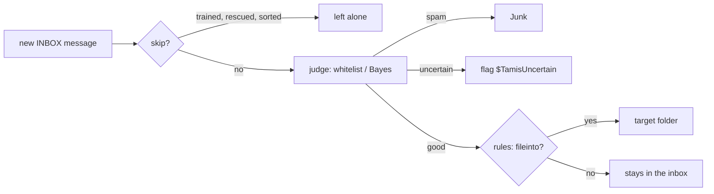

# Filing rules

Status: implemented. Good mail can be filed into folders by a Sieve script, in
addition to spam filtering and rescue. Spam filtering remains tamis's core job;
filing is a second stage that runs only on mail already judged good.

## Why Sieve, and why here

Sieve ([RFC 5228](https://www.rfc-editor.org/rfc/rfc5228)) is the standard
language for mail filtering. Servers such as Dovecot, Cyrus, Stalwart and
Fastmail run it at delivery. iCloud doesn't (see [design.md](design.md)), so
tamis runs the script itself, client-side, over IMAP. Because the rules are
plain Sieve, they move to a server-side filter unchanged if the provider
changes.

The script is evaluated by [`foxcpp/go-sieve`](https://github.com/foxcpp/go-sieve),
an embeddable interpreter. It is a pre-1.0 module (a pseudo-version in
`go.mod`), so upgrades deserve a test run.

## Configuration

```toml
[rules]
script = "~/.config/tamis/rules.sieve"   # empty (the default) files nothing
```

The script is compiled when the configuration loads, so `tamis run`, `tamis
web` and every other command refuse to start on a script that doesn't parse:
a mistake never surfaces halfway through a pass.

```sieve
require ["fileinto", "body"];

if header :contains "list-id" "golang-nuts" {
    fileinto "Lists/Go";
    stop;
}
if address :is "from" "billing@shop.example" {
    fileinto "Receipts";
}
```

## Where it runs



Rules run in `Engine.handle` (`internal/engine/engine.go`) after `judge`, and
only for a **good** verdict, whether it came from the whitelist or the model.
They never see spam, which goes to Junk first, and never see uncertain mail,
which stays in the inbox for the user. A rule therefore can't hide a message
the filter was unsure about.

The result is the first `fileinto` without `:copy`. Everything else a Sieve
script can do is ignored, since only filing makes sense over IMAP: `redirect`
is denied, `keep` and `discard` leave the message where it is, and flags are
not applied. A script error on one message is logged and the message is left
in place, so one odd message can't stall the pass.

## Actions and the journal

| Mode | What happens | Journal |
|---|---|---|
| live | create the folder if missing, add `$TamisSorted`, move | verdict `good`, reason `rule`, action `move:<folder>`, applied |
| shadow | nothing | same entry, not applied |

The verdict stays `good`, so spam-correction logic (which only trusts `move:`
entries with a spam verdict) is unaffected. A failed move removes
`$TamisSorted` again, the way a failed spam move removes `$TamisFiled`.

`$TamisSorted` is a separate keyword on purpose. `$TamisFiled` means "tamis
moved this to Junk", and seeing it in the inbox is read as the user rescuing
the message. Reusing it would teach the filter that filed mail was spam. The
pass skips a message that carries `$TamisSorted`, so one the user drags back
into the inbox isn't filed again.

Rule-filed mail is not trained either way, and it is not undoable: `tamis
undo` and the web interface's undo only cover `bayes` and `whitelisted`
decisions. Move the message back by hand.

## Looking at and checking the rules

| | |
|---|---|
| `tamis rules show` | print the configured script |
| `tamis rules check [file]` | compile a script (default: the configured one); exits 1 with the parse error |
| `tamis rules test message.eml` | print the folder the configured script files a message into, or that it stays |
| web **Rules** page | the script's path, valid or invalid, its source, and a form that tries a pasted message |

`check` with a file argument needs no configuration, so a new script can be
vetted before it is switched on. The web page re-reads the file on every
view, so it shows edits made after the daemon started. The running daemon,
however, compiled the script at startup: restart `tamis run` to apply an edit.

## Limitations

- Only the first 256 KiB of a message is fetched, so `body` tests don't see
  past that. Header tests are unaffected.
- Header values are matched as they appear on the wire; encoded words
  (`=?utf-8?...?=`) aren't decoded first.
- The envelope has only the `From` address, so `envelope` tests on the
  recipient see nothing.
- Existing inbox mail is not back-filled; only mail that arrives after the
  first run is filed.
- Only the inbox-side watch folders are filed from. Mail in other folders is
  untouched.
